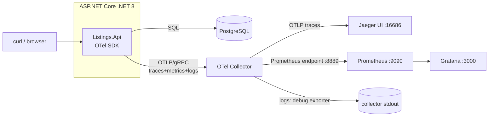

# OpenTelemetry on .NET: a small learning demo

A tiny ASP.NET Core (.NET 8) + PostgreSQL "listings and bids" service, instrumented with OpenTelemetry
(traces, metrics, logs). It includes one **deliberately slow** endpoint, a walk-through of finding the
bottleneck in a Jaeger trace, and a measured fix.

> **This is a learning demo, not production software.** See [Limitations](#limitations).
> Companion docs: [flow.md](flow.md) (how a request and its telemetry travel) and
> [Decisions.md](Decisions.md) (why each choice was made).

## Architecture



## Run it

Requirements: Docker with Compose, and (for tests / local dev) the .NET 8 SDK.

```bash
docker compose up -d --build
curl localhost:8080/listings/1
curl "localhost:8080/listings/search?category=cars&limit=5"
curl -XPOST localhost:8080/listings/1/bids -H 'content-type: application/json' -d '{"bidder":"alice","amount":50000}'
curl localhost:8080/listings/5/shipping     # one trace spanning two HTTP hops
```

| UI | URL |
|---|---|
| Jaeger (traces) | http://localhost:16686 |
| Prometheus (metrics) | http://localhost:9090 |
| Grafana (dashboard "Listings API") | http://localhost:3000 (anonymous admin, local only) |

Metrics are exported every 60 s by default, so wait about a minute before they appear in Prometheus.

Endpoints: `GET /listings/{id}`, `POST /listings/{id}/bids`, `GET /listings/search` (fixed),
`GET /listings/search/slow` (deliberately slow), `GET /listings/{id}/shipping` (calls the service itself over HTTP).

Tests: `dotnet test` (11 tests; the integration tests need Docker and start PostgreSQL via Testcontainers).

## What each signal is for

| Signal | Question it answers | Where we see it | Our code |
|---|---|---|---|
| **Traces** | "Where did the time go in *this one* request?" | Jaeger | auto spans (ASP.NET Core, HttpClient, Npgsql) + manual spans `search.nplusone`, `search.batched`, `bids.place` |
| **Metrics** | "Is it getting slower or failing *overall*?" | Prometheus / Grafana | `listings.bids.placed` (counter), `listings.search.duration` (histogram), plus built-in `http.server.request.duration` |
| **Logs** | "What did the code say happened?" | collector stdout (no log UI here) | `ILogger` output; records carry TraceId/SpanId so a log line can be linked to its trace |

Typical workflow: a metric/alert tells you *that* something is slow, a trace tells you *where*, a log tells you *why*.

## Walk-through: finding the bottleneck with a trace

1. Start the stack (no index on `bids.listing_id`). Call the slow endpoint a few times:
   `curl "localhost:8080/listings/search/slow?category=cars"`
2. Open Jaeger, service `listings-api`, operation `GET /listings/search/slow`, open the slowest trace.
3. In the trace I measured (one run): the root span took **~620 ms** and contained **53 spans**: the
   server span, our manual `search.nplusone` span, and **51 Npgsql spans** named `listings` (Npgsql names
   spans after the database). Each of the 50 per-listing spans carries
   `db.statement = SELECT max(amount), count(*) FROM bids WHERE listing_id = @id` and took roughly 11 ms.
   One query repeated 50 times in sequence is the classic **N+1** signature. The span time is dominated by
   the database, not by .NET code.
4. Why each query is slow: `EXPLAIN ANALYZE` on that statement showed a **Parallel Seq Scan** over all
   ~400k bids rows (no index on `listing_id`).
5. Two fixes, measured separately so we know which one matters:
   * **Batch** the queries (`/listings/search`): 2 SQL spans instead of 51 (confirmed in its trace).
   * **Add the index**: `docker compose exec postgres psql -U demo -d listings -f /db/add-index.sql`
     (plan became a Bitmap Index Scan). Undo with `db/drop-index.sql`.

### Measured results

`scripts/bench.sh <path> 50`: 50 sequential requests after 3 warm-ups, client-side time from `curl`,
single run on one machine (4 vCPU Linux sandbox, everything including Postgres in Docker on the same host).
Raw output in [docs/bench-results.txt](docs/bench-results.txt).

| Variant | Index on `bids(listing_id)` | min | median | p95 |
|---|---|---|---|---|
| N+1 (`/search/slow`) **before** | no | 537.8 ms | **583.5 ms** | 628.8 ms |
| Batched (`/search`) | no | 17.4 ms | 19.9 ms | 25.1 ms |
| N+1 | yes | 29.7 ms | 40.3 ms | 47.0 ms |
| Batched **after (both fixes)** | yes | 4.6 ms | **5.5 ms** | 7.3 ms |

Reading it honestly: on this data set, batching alone gave ~29x (583 → 20 ms) and the index alone ~14x
for the N+1 version; together ~106x (583 → 5.5 ms). These are one run on a laptop-class sandbox with
synthetic data, so treat them as illustrative, not as benchmarks. Re-run them yourself.

## Project layout

```
src/Listings.Api/   service: Program.cs (OTel setup + endpoints), Telemetry.cs, ListingsRepository.cs, BidRules.cs
tests/Listings.Tests/   unit tests + Testcontainers integration tests
db/                 schema, seed data, add-index / drop-index scripts
otel/               collector, prometheus, grafana provisioning + dashboard
scripts/bench.sh    timing helper
```

## Limitations

* A learning demo: no authentication, no input hardening beyond basic validation, demo passwords in
  `docker-compose.yml`, Grafana runs with anonymous admin. Do not expose it.
* **Logs have no backend**: the Collector just prints them. There is no Loki/Elastic, so you cannot browse logs next to traces.
* **No sampling** (100% of traces), no tail-based sampling, no Collector scaling or auth. Production needs all of these.
* No alerts or SLOs are defined; the Grafana dashboard has four basic panels. I verified its queries return data
  but did not visually review every panel.
* Not run on Kubernetes or AWS. Nothing here covers deployment, the Collector as a DaemonSet/sidecar, or the OpenTelemetry Operator.
* Single service, so "distributed" tracing is only shown by the service calling itself over HTTP.
* The `db.statement` attribute stores SQL text (parameters excluded). Real systems must think about sensitive data in telemetry.
* The `Dockerfile` could not be built in the sandbox where this was authored (no route to NuGet from inside
  the build container); the stack there was run with a host-published build instead. Please run
  `docker compose up --build` once on your own machine to confirm. Likewise the GitHub Actions workflow
  has not been executed yet (the same commands run locally and pass).
* Benchmark numbers are single-machine, single-run, synthetic data.
