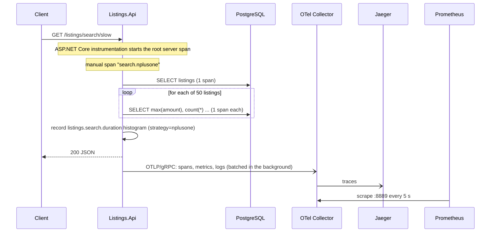

# Flow and structure

## Code structure

| File | Role |
|---|---|
| `src/Listings.Api/Program.cs` | Builds the app: registers the DB, **configures OpenTelemetry**, defines the HTTP endpoints. |
| `src/Listings.Api/Telemetry.cs` | Our own `ActivitySource` (spans) and `Meter` (counter + histogram). |
| `src/Listings.Api/ListingsRepository.cs` | All SQL (Dapper). Slow N+1 search, batched search, place-bid transaction. Contains the manual spans. |
| `src/Listings.Api/BidRules.cs` | Pure validation logic, no I/O (easy to unit test). |
| `db/*.sql` | Schema (no index), seed data, `add-index.sql` (the fix), `drop-index.sql`. |
| `otel/` | Collector pipeline, Prometheus scrape config, Grafana datasource and dashboard. |
| `tests/Listings.Tests` | Unit tests (rules, telemetry instruments) and Testcontainers integration tests. |

## Startup flow

1. `docker compose up`: PostgreSQL starts and runs `01-schema.sql` then `02-seed.sql` (2,000 listings, 400,000 bids) the first time.
2. The Collector, Jaeger, Prometheus and Grafana start; the API starts once Postgres is healthy.
3. `Program.cs` reads `OTEL_EXPORTER_OTLP_ENDPOINT` (set in compose). If present, the OTLP exporters are
   attached to traces, metrics and logs. If absent (tests), nothing is exported.

## Request flow: `GET /listings/search/slow`

Key point: exporting happens in the background, after the response, so telemetry does not add request latency.

## Trace-context propagation: `GET /listings/{id}/shipping`

1. The server span for `/listings/5/shipping` is created.
2. The handler calls `/internal/shipping-rate` through `HttpClient`. The HttpClient instrumentation
   creates a client span and adds a W3C `traceparent` header (trace id + parent span id).
3. The receiving side's ASP.NET Core instrumentation reads `traceparent` and creates its server span
   **under** that client span. Result seen in Jaeger: one trace, three spans
   (`GET /listings/{id:int}/shipping` → `GET` → `GET /internal/shipping-rate`).
   Across two real services the mechanism is identical.

## Where each signal goes

| Signal | App → | Collector → | Viewed in |
|---|---|---|---|
| Traces | OTLP gRPC :4317 | `otlp/jaeger` exporter | Jaeger :16686 |
| Metrics | OTLP gRPC :4317 | `prometheus` exporter (:8889), scraped by Prometheus | Prometheus :9090, Grafana :3000 |
| Logs | OTLP gRPC :4317 | `debug` exporter | `docker compose logs otel-collector` |

## Bid flow: `POST /listings/{id}/bids`

Manual span `bids.place` → open transaction → `SELECT ... FOR UPDATE` on the listing → read highest bid →
`BidRules.Validate` → insert → commit → increment `listings.bids.placed` (tagged by category) → log line.
Responses: 201 accepted, 409 rejected with reason, 404 unknown listing.
